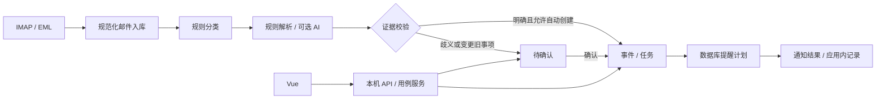

# OfferPilot Lite 详细设计总览

版本：0.1 评审草案｜日期：2026-11-09｜状态：待用户确认

## 1. 依据与阅读方式

依据：[PRD V1.0](../../../OfferPilot_Documents_v1.0/docs/OfferPilot_PRD_v1.0.md)、[HLD V1.0](../../../OfferPilot_Documents_v1.0/docs/OfferPilot_Technical_Design_v1.0.md)。原文作为需求基线，本组文档补充接口、数据约束和异常语义。新增默认值都是设计提案，不代表已获批准。

先读本总览，再按[确认清单](offerpilot/15-review-and-acceptance.md)逐组评审。所有代码路径为拟创建路径；文档不代表已有实现。确认后再编写工作包实施计划并开发。

## 2. 方案比较

| 方案 | 优点 | 代价 | 建议 |
| --- | --- | --- | --- |
| A 本地 Python + 浏览器 + 托盘 | 符合 HLD，数据本地化，部署较简单 | 要解释关闭页面与退出程序的区别 | 推荐 |
| B 本地服务 + WebView 桌面壳 | 独立窗口体验 | 增加运行时、打包兼容成本 | 后续评估 |
| C 云服务 + 网页/手机 | 电脑关闭时仍可监听 | 账号、隐私、托管成本与安全范围扩大 | 超出首版 |

推荐 A：Python 3.12、FastAPI/Uvicorn 单 worker、SQLAlchemy 2/Alembic、SQLite、Vue 3/TypeScript/Vite、Windows 凭据库、PyInstaller onedir/Inno Setup。精确依赖版本在开发环境工作包中验证和锁定。

## 3. 范围和分期

- **P0 / V0.1→V0.2：** EML 导入、单个 QQ 邮箱 INBOX 只读同步、规则分类和解析、待确认、任务编辑、Windows/应用内提醒、诊断、CSV/JSON 导出、备份恢复、向导、托盘、安装包。
- **P1 / V0.3→V0.4：** 可选 AI、申请阶段聚合/看板、改期关联向导、日历冲突、第二邮箱、一个移动通知渠道。此次设计业务合同，开发作为独立增量。
- **P2：** 准备建议、托管/多端、ICS/日历同步、QQ 机器人等只定义扩展边界，不纳入此次开发验收。

P0 对改期/取消必须识别并送审，不自动建立第二个有效日程。用户可编辑或取消既有任务；P1 增加完整关联确认流程。P0 有基础申请实体与手工归属，自动阶段聚合和看板属于 P1。

## 4. 模块文档

| 编号 | 文档 | 负责内容 |
| --- | --- | --- |
| M01 | [运行生命周期](offerpilot/01-runtime.md) | 单实例、线程、启动/退出、恢复 |
| M02 | [数据与事务](offerpilot/02-data.md) | 表、约束、并发、迁移 |
| M03 | [邮件接入](offerpilot/03-mail.md) | QQ、同步、游标、MIME、导入 |
| M04 | [邮件分类](offerpilot/04-classifier.md) | 规则、类型、忽略与反馈 |
| M05 | [事件解析与 AI](offerpilot/05-parser.md) | 时间、证据、多动作、回退 |
| M06 | [审核与申请](offerpilot/06-review-application.md) | 审核、阶段、归属、改期 |
| M07 | [任务与日历](offerpilot/07-task-calendar.md) | CRUD、人工覆盖、冲突 |
| M08 | [提醒调度](offerpilot/08-reminder.md) | 排程、领取、重试、漏提醒 |
| M09 | [通知渠道](offerpilot/09-notification.md) | Windows、应用内、外部通知 |
| M10 | [设置与安全](offerpilot/10-settings-security.md) | 凭据、会话、隐私、配置 |
| M11 | [本地 API](offerpilot/11-api.md) | 请求响应、错误、版本控制 |
| M12 | [前端与向导](offerpilot/12-ui.md) | 页面、状态、交互与可访问性 |
| M13 | [备份与数据管理](offerpilot/13-backup.md) | 导出、恢复、删除、保留 |
| M14 | [工程与交付](offerpilot/14-engineering-and-delivery.md) | Git、环境、日志、安装、测试 |
| 评审 | [确认与验收矩阵](offerpilot/15-review-and-acceptance.md) | 决策、需求追踪、实施顺序 |

## 5. 数据流和依赖

依赖为 `api → services → domain`，仓储与外部适配器由接口注入。领域层不导入 FastAPI、SQLAlchemy、Windows API。用例服务持有事务，Worker 复用用例逻辑。

邮件持久化和业务生成分两个事务，通过持久化处理状态恢复。解析失败不阻止已落库邮件的同步游标推进；游标不能越过未保存邮件。网络请求不在数据库写事务中执行。

## 6. 全局不变量

1. Mail、Event、Task 有稳定 UUID；一封邮件可产生多个事件、每个事件多个动作。
2. 邮件传输去重与业务去重分开；重新解析不以解析器版本生成新任务。
3. 人工修改字段不被规则或 AI 覆盖；自动结果仅提出差异建议。
4. 不明确的年份、时区、相对期限参照必须确认；仅有日期不补 23:59。
5. 只有确认过的精确时刻参与自动定时提醒。
6. 任务时间修改、旧提醒失效和新提醒建立在同一事务中提交。
7. 通知送达系统不等于用户已读；发送结果未知时不能无限重发。
8. 凭据不进入数据库、备份、日志、模型上下文或浏览器持久存储。
9. 删除邮箱默认保留已有任务；删除个人数据单独确认。
10. 显式退出、关机、休眠后不承诺持续同步或准点提醒。

## 7. 对概要设计的补充

| 原文尚未明确处 | 推荐决策 |
| --- | --- |
| UID 重建与重扫去重 | 增加 mail_occurrences，邮件内容与出现位置分开 |
| 日期未知时刻 | 分开 due_date 与 due_at，保存 precision 与确认状态 |
| 同封邮件多个时间 | 每个动作携带独立 temporal，不共享一个截止时间 |
| 改期 P1 与 A4 验收 | P0 拦截送审，P1 实现安全关联更新 |
| 无注册登录但 API 需保护 | 启动器一次性引导码换会话 Cookie |
| settings.json 与事务一致性 | 业务设置放 SQLite；JSON 仅存启动级参数 |
| 通知发送后崩溃 | delivery_unknown，可见但不盲目重发 |
| Windows 环境差异 | 包含 tzdata、应用通知身份与安装演练 |

## 8. 评审门槛

按用户“确认后执行开发”的要求，当前仅建立文档与 Git 基线。确认顺序为 A 架构/工程、B 邮件/解析、C 任务/提醒、D 界面/备份。用户可以逐组修改或一次批准全部推荐项。确认记录只能根据用户实际回复填写。

P1 设计不自动授权 P1 开发。批准后先完成本地任务闭环和工程环境，再逐步加入邮件与提醒；详细顺序见评审文档。
