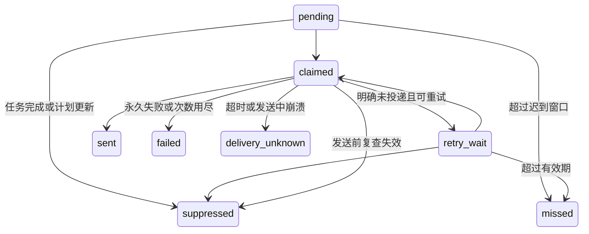

# M08 提醒调度详细设计

状态：待确认｜范围：P0｜需求：F06、A4/A6/A10、NFR-04/05

## 1. 计划生成

拟建 `domain/reminder.py`、`services/reminder_planning.py`、`workers/reminders.py`。`plan(task, template, now) → ReminderPlan[]` 为纯函数；数据库是唯一计划来源。

默认模板：面试/笔试 starts_at 前 24h、1h、15min；测评/材料 due_at 前 24h、3h；回复/Offer 前 24h、1h；手动任务由用户选择，默认截止前 1h。用户可修改，offset 必须非负且不超过 30 天。

仅 confirmed、precision=minute、状态可执行、基准在未来的任务产生计划；每条 fire_at 必须严格晚于创建/重算时刻。模板时间全已过但任务尚未到点时，在应用内显示“临近时间，模板提醒已错过”，提供“现在提醒”按钮，不擅自补发多个通知。

幂等键 `task_id:schedule_revision:channel:offset_seconds`；同事务更新任务、旧记录 suppressed、新记录 pending。不同渠道分别记录；通知中心根据 reminder_id 去重。

P0 只为 windows 创建外部发送计划，应用内记录是同一提醒的状态投影，不再创建第二条 in_app 发送计划。系统通知关闭时计划仍到点结算为渠道不可用，应用内显示待处理事项和原因。P1 每个额外渠道独立建立计划。

## 2. 状态机

sent/failed/missed/delivery_unknown/suppressed 均不自动回到 pending；用户手动重试产生新显式请求并提示可能重复，记录原 reminder 关系。

## 3. 领取、发送与竞态

每 15 秒扫描最多 50 条，排序 fire_at、id。短 `BEGIN IMMEDIATE` 事务原子领取，设置 lease_until=now+60s。每个任务共用进程内互斥锁：任务更新与最终发送检查均持该锁；锁内重查 status、schedule_revision、过期时间，持久化 attempt started 后调用通知适配器（超时最多 10 秒），写结果后释放。

这保证已成功返回的取消操作之后不会再开始旧提醒发送。如果通知已在发送，取消操作最多等待该次发送结束，再使其他计划失效；已交给系统的通知不承诺撤回。数据库写事务不跨网络调用。

领取后未记录 attempt 即崩溃，lease 过期可归还 pending；attempt started 无 finished 的恢复为 delivery_unknown，不当作确定失败重试。

## 4. 重试、恢复、安静时段

- 明确未投递的暂时错误：30 秒、120 秒后重试，总发送次数最多 3；重试时仍校验任务版本与 expires_at。
- expires_at=min(fire_at+10min, task_anchor)；now>=expires_at 标 missed。时间过去的任务不会收到“还有 1 小时”之类过期提示。
- 恢复时全部逾期计划入历史，应用内按任务去重；每次恢复批次最多一个系统摘要，说明有 N 项可能错过。摘要发送也有唯一 recovery_batch_id 和尝试记录，不能启动时反复弹出。
- 默认安静时段关闭。用户启用后一般通知延至安静时段结束；若延后越过任务基准则不发送历史提醒，标 missed。高优先级是否打破安静时段由用户显式选择，默认不打破，设置页展示风险。
- 延后按钮提供 10/30/60 分钟，只允许新时间早于任务基准；否则要求修改提醒策略，不修改截止。

scheduled_for 保存模板原始时刻，fire_at 保存安静时段调整后的实际计划；expires_at 按实际 fire_at 计算。若安静时段结束不早于任务基准，计划直接标 missed，不生成越过截止的计划。用户延后产生 parent_reminder_id 指向旧提醒的新计划，幂等键使用原键加显式命令 UUID，旧计划 suppressed，防止同一次点击重试创建多条。

## 5. 用户可见语义

pending=已安排；claimed=发送中；sent=已交给通知渠道；failed=发送失败；delivery_unknown=发送结果未确认；missed=可能错过；suppressed=已取消旧计划。禁止用“已读”代替 sent。显示最近一次结果、下一次 fire_at、错误操作建议。

## 6. 验收

同一提醒被两次扫描只发送一次；任务修改与领取竞态符合上述顺序；模拟发送成功后数据库结果丢失进入 unknown 而不自动重发。完成任务后无可执行计划；重启恢复不丢计划；休眠 2 天只产生一次摘要。所有测试使用假时钟和可控 adapter，不真实等待一天。
